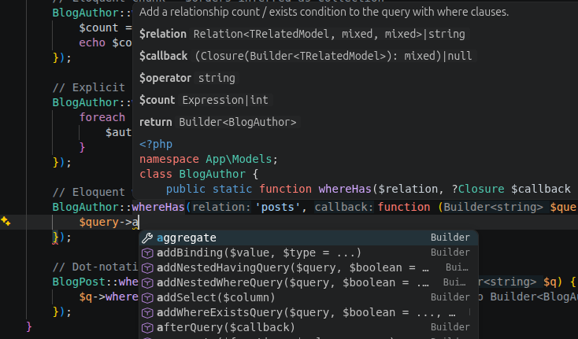

# PHPantom

Fast PHP language support powered by [PHPantom](https://github.com/PHPantom-dev/phpantom_lsp), a language server with deep type intelligence, generics, and framework awareness. Works in VS Code, Cursor, and other VS Code-based editors, available on the [Visual Studio Marketplace](https://marketplace.visualstudio.com/items?itemName=phpantom.phpantom) and [Open VSX](https://open-vsx.org/extension/phpantom/phpantom).

## Getting Started

1. Disable the editor's built-in PHP language features: open Extensions, search for `@builtin php`, and disable **PHP Language Features**. Leave **PHP Language Basics** enabled for syntax highlighting.
2. Disable other PHP language servers (Intelephense, Phpactor, PHP Tools) to avoid duplicate results.
3. Open a PHP project. PHPantom downloads and starts the language server automatically.

## Features

**Language intelligence.** Type-aware completion with automatic imports, signature help, hover, go to definition/implementation, find references, rename, call and type hierarchy, inlay hints, code lens, semantic highlighting, and PSR-12 formatting (with optional Laravel Pint). Understands generics (`@template`) and PHPStan/Psalm annotations, and is framework-aware, including Laravel Eloquent.

**Diagnostics and code actions.** Undefined symbols, type errors, argument mismatches, deprecated usage, and unused imports. Refactorings such as extract/inline variable, extract method, generate constructor/getters/setters, implement interface methods, and PHPDoc generation.

**Templates and config files.** Full support in Blade templates, with the editor's HTML completion and Emmet still active in the markup. In Twig, YAML, and XML files, template names, routes, translation keys, services, and class names complete, navigate, and rename alongside the extensions you already use for those languages (Twig needs an extension that provides the `twig` language).

**Laravel tooling.**

- **Artisan command runner.** Pick a command, fill in its arguments, and run it in the terminal.
- **Class generation.** Create models, controllers, migrations, and more via `artisan make:*`, from the command palette or by right-clicking a folder.
- **Route list.** A filterable panel of your routes with click-through to the controller method.
- **Model annotations.** Generate `@property` docblocks on Eloquent models from your database schema.
- **Log viewer.** Tails `storage/logs/*.log` with highlighting and clickable stack traces.

These tools run your application only when you invoke them. The language server itself never runs your code; its analysis is purely static.

## Settings

The most common settings are below. Search for `phpantom` in the Settings UI for full descriptions.

| Setting | Default | Description |
| --- | --- | --- |
| `phpantom.rootDir` | `""` | Subdirectory that holds the PHP project (such as `api`), when it is not the workspace folder itself. |
| `phpantom.phpPath` | `""` | PHP executable for artisan commands. Empty uses `php` on `PATH`. |
| `phpantom.inlayHints.parameterNames` | `true` | Parameter name hints at call sites. |
| `phpantom.inlayHints.closureTypes` | `true` | Inferred return type hints on closures and arrow functions. |
| `phpantom.serverPath` | `""` | Path to a custom `phpantom_lsp` binary. |
| `phpantom.autoDownload` | `true` | Download the server automatically if it is not found. |
| `phpantom.autoUpdate` | `true` | Check for newer server releases periodically. |
| `phpantom.updateCheckIntervalHours` | `24` | How often to check for updates (1-168 hours). |
| `phpantom.releaseTag` | `"latest"` | Server release to download. |
| `phpantom.trace.server` | `"off"` | Trace communication with the language server. |

Your `files.exclude` and `files.associations` settings are also passed to the language server, so excluded folders stay out of the index and patterns mapped to `php` are analysed as PHP.

Per-project analysis options live in a `.phpantom.toml` file. See the [language server documentation](https://github.com/PHPantom-dev/phpantom_lsp) for details.

## Commands

All commands are in the command palette under **PHPantom:**.

| Command | Description |
| --- | --- |
| Restart Language Server | Restart the server, applying any downloaded update. |
| Show Output | Open the PHPantom output channel. |
| Show Server Version | Show the running server version. |
| Check for Server Update | Check for a newer server release. |
| Clear Downloaded Language Server | Remove cached server binaries. |
| Toggle Inlay Hints | Show or hide all PHPantom inlay hints at once. |
| Show Logs | Open the log viewer. |
| Run Artisan Command | Pick and run an artisan command. |
| New Laravel Class... | Generate a class via `artisan make:*`. |
| Show Route List | Open the route list panel. |
| Generate Model Annotations | Write `@property` docblocks from the database schema. |
| Regenerate Model Annotations | Refresh existing annotations without prompting. |

## Language Server Binary

The extension looks for a server binary in this order: the `phpantom.serverPath` setting, `phpantom_lsp` on `PATH`, a previously downloaded binary, and finally a fresh download from [GitHub Releases](https://github.com/PHPantom-dev/phpantom_lsp/releases). Updates are downloaded in the background and take effect the next time the server restarts.

If the download fails or your platform has no prebuilt binary, check the **PHPantom: Show Output** channel for details, then download or build one yourself (`cargo install phpantom_lsp`) and set `phpantom.serverPath`.

## Learn More

- [PHPantom language server](https://github.com/PHPantom-dev/phpantom_lsp): documentation and `.phpantom.toml` configuration
- [Server changelog](https://github.com/PHPantom-dev/phpantom_lsp/blob/main/docs/CHANGELOG.md): improvements to type intelligence, diagnostics, and completion
- [Report an extension issue](https://github.com/PHPantom-dev/phpantom_vsix/issues)

## License

[MIT](LICENSE)
